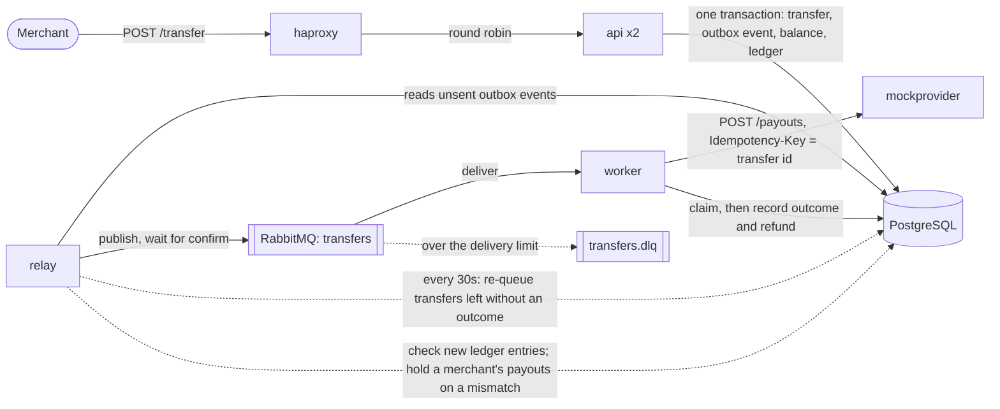

# moneytransfer

A payout service in Go. A merchant submits a bank transfer with `POST /transfer`; the merchant
balance is deducted right away, and the payout happens in the background through RabbitMQ and a
payment provider. A failed payout is refunded. Postgres keeps balances, transfers and a ledger
of every balance change.

What it guarantees:

- Concurrent requests never overdraw the balance.
- A retried request (same `Idempotency-Key`) never creates a second transfer.
- A transfer is never paid out twice, even when the provider times out or a worker crashes.
- A failed transfer is refunded exactly once, and only when the provider says it failed.
- The balance always equals the sum of its ledger entries.

Stack: Go 1.26, PostgreSQL 18, RabbitMQ 4.3 (quorum queues), HAProxy 3.4, Docker Compose.

## Important notes

### Data protection

Recipient bank details are personal data under Indonesia's Personal Data Protection Law
(UU 27/2022), and account numbers count as specific (financial) personal data. The service:

- masks account numbers everywhere except the database: logs and API responses show `****6789`;
- never logs request bodies or the transfer description, and never puts personal data in error
  messages;
- sends only ids through RabbitMQ (`transfer_id`, `correlation_id`), so the broker and its UI
  hold no personal data;
- keeps the full values only in Postgres, which the payout needs and which serves as the audit
  trail. Logs reach a transfer through its `transfer_id` or `correlation_id`.

Not done here, needed in production: encryption of account numbers at rest, a retention and
deletion policy, database access auditing, and a breach-notification process (the law gives
3 x 24 hours).

### Other notes

- Amounts are integers in whole rupiah (IDR only). There are no fractions anywhere.
- Passwords in `docker-compose.yml` and `.env.example` are local development values.
- There is no authentication: one hardcoded merchant (`merchant_id = 1`).

## Quick start

Requirements: Docker Engine 25+ with Compose v2.20+ (Docker Desktop works). `make` is optional;
every target's raw command is shown next to it. Go 1.26 is only needed to run the tests outside
Docker. The commands are for bash; on Windows use Git Bash or WSL (in Windows PowerShell,
`curl` is a different command).

### 1. Run it

```bash
make up
```

Without make: `docker compose up -d --build --wait`. This builds one image with all binaries,
starts Postgres, RabbitMQ and the services, runs the migrations, and seeds merchant 1 with
1,000,000,000 rupiah. It returns once everything is healthy.

| Service | What it does | Host port |
|---|---|---|
| `haproxy` | Spreads requests over the api replicas | `18080` |
| `api` (2 replicas) | HTTP API: validates, deducts the balance, stores the transfer | - |
| `relay` | Publishes stored events to RabbitMQ, re-queues stuck transfers, checks the ledger | - |
| `worker` | Calls the provider, records the outcome, refunds failures | - |
| `mockprovider` | Fake bank with random delays and outcomes | - |
| `postgres`, `rabbitmq` | Storage and broker (RabbitMQ UI: user and password `moneytransfer`) | `18672` (UI) |
| `migrate`, `seed` | One-shot jobs that create the schema and the merchant | - |

Both ports listen on 127.0.0.1 only, so the unauthenticated API and the RabbitMQ UI are not
reachable from the network. Ports and every other setting can be changed in a `.env` file (copy
`.env.example`, which lists all variables with their defaults).

### 2. Try it by hand

Submit a transfer:

```bash
curl -i -X POST localhost:18080/transfer \
  -H 'Content-Type: application/json' \
  -H 'Idempotency-Key: demo-1' \
  -d '{"amount":150000,"currency":"IDR","bank_code":"BCA","account_number":"1234566789","account_holder_name":"Budi Santoso","reference_id":"INV-001"}'
```

```
HTTP/1.1 202 Accepted
Location: /transfer/01a1d891-e9f2-7ee6-9809-e740d06dba54
X-Correlation-Id: 69306aea-ab47-406d-a3bd-61fa8c0257c6

{"id":"01a1d891-e9f2-7ee6-9809-e740d06dba54","status":"PENDING","amount":150000,"currency":"IDR",
 "bank_code":"BCA","account_number":"****6789","account_holder_name":"Budi Santoso",
 "reference_id":"INV-001","failure_code":null,"created_at":"...","updated_at":"..."}
```

The api answers in a few milliseconds, with the balance already deducted. The payout runs in the
background; the fake bank takes 0.2-2 seconds to answer (`MOCK_MIN_DELAY` and `MOCK_MAX_DELAY`
in `.env`), so check again a moment later:

```bash
curl localhost:18080/transfer/01a1d891-e9f2-7ee6-9809-e740d06dba54
```

```
{"id":"01a1d891-...","status":"SUCCESS",...}
```

About 1 in 10 transfers ends `FAILED` and a few end `UNKNOWN`. That is on purpose: see
[Simulated provider errors](#simulated-provider-errors).

Send the same POST again: the answer is the same transfer with `Idempotent-Replayed: true`, and
nothing is deducted twice. Change the body but keep the key, and the answer is
`422 IDEMPOTENCY_KEY_REUSED`. Use a new key for a new transfer.

#### Simulated provider errors

The fake provider fails on purpose, so the failure paths can be seen, in two ways.

**On demand.** Account numbers ending in these digits always give the same outcome:

| Ends in | Provider does | Transfer ends as |
|---|---|---|
| `0001` | Rejects with `INVALID_ACCOUNT` | `FAILED` (`failure_code: INVALID_ACCOUNT`), balance refunded |
| `0002` | Pays, but the answer arrives after the worker gave up | `SUCCESS` after a retry with the same key, paid once |
| `0003` | Answers 503 every time | `UNKNOWN` after 3 attempts, money stays held; checked again 8 times over about 3 hours, then an alert |
| `0004` | Rejects with a code the service doesn't know | `UNKNOWN`, money stays held (never refunded on a guess); checked again 8 times over about 3 hours, then an alert |

**At random,** for any other account number:

- about 10% are rejected with a bank error such as `REJECTED_BY_BANK`;
- about 5% are paid, but the answer comes too late; the worker retries and gets `SUCCESS`;
- about 5% get a 503; the worker retries, and most of them end `SUCCESS`.

The three percentages are settings of the fake provider: `MOCK_FAILURE_PERCENT` (default 10),
`MOCK_TIMEOUT_PERCENT` (5) and `MOCK_UNAVAILABLE_PERCENT` (5). Setting all three to 0 turns the
random errors off, for example for a clean demo. Only the fake provider restarts; the data stays.

*Option 1, for one run (bash).* Type this in the terminal, in the project folder:

```bash
MOCK_FAILURE_PERCENT=0 MOCK_TIMEOUT_PERCENT=0 MOCK_UNAVAILABLE_PERCENT=0 make up
```

To turn the random errors back on, type:

```bash
make up
```

*Option 2, until changed back (any terminal).* Copy the example settings file to `.env`:

```bash
cp .env.example .env
```

Open `.env` in an editor, change these three lines to 0, save, and run `make up`:

```
MOCK_FAILURE_PERCENT=0
MOCK_TIMEOUT_PERCENT=0
MOCK_UNAVAILABLE_PERCENT=0
```

To turn them back on, set the lines back to 10, 5 and 5 (or delete `.env`), and run `make up`
again. `.env` is local only; git ignores it.

**What happens after an error.** The worker retries timeouts and 503s by itself, up to 3 attempts,
always with the same provider key, so a retry never pays twice. Then:

- `FAILED` is final, and the amount is already back on the balance. To try again, send a new
  request with a new `Idempotency-Key`; the old key returns the failed transfer.
- `UNKNOWN` means the provider gave no clear answer, so the bank may have paid. The money stays
  held. Don't resubmit, which could pay twice. The relay sends the transfer to the worker again
  after 1 minute (`RECONCILE_AFTER`), then after 2, 4, 8 minutes and so on, up to an hour
  between checks; the worker asks the provider with the same key each time, so the status may
  briefly show `PROCESSING` and then `SUCCESS` or `FAILED`. After 8 checks
  (`RECONCILE_MAX_ATTEMPTS`, about 3 hours) without an answer, the relay logs
  `alert=reconcile_exhausted` with the transfer ids every 5 minutes until a person resolves them.

To watch this without waiting, start the stack with a short gap and fewer checks, and send a
transfer to an account ending in `0003`; within about 5 minutes `docker compose logs relay` shows
the alert:

```bash
RECONCILE_AFTER=10s RECONCILE_MAX_ATTEMPTS=3 make up
```

Request rules:

| Field | Rule |
|---|---|
| `Idempotency-Key` header | Required, 1-255 characters |
| `amount` | JSON integer, 1 to 250,000,000 |
| `currency` | `IDR` |
| `bank_code` | 2-20 letters or digits |
| `account_number` | 5-20 digits (kept as text, leading zeros matter) |
| `account_holder_name` | 1-100 characters |
| `reference_id`, `description` | Optional, up to 64 and 255 characters |

Unknown fields are rejected, and all field errors come back at once. Errors use RFC 9457
problem details with a stable `code`:

```
{"type":"about:blank","title":"Bad Request","status":400,"detail":"The request has invalid fields.",
 "code":"VALIDATION_FAILED","correlation_id":"9a4d05a9-...",
 "errors":[{"field":"amount","message":"must be greater than 0"},{"field":"currency","message":"must be IDR"}]}
```

| Status | When |
|---|---|
| 202 | Accepted, also for a replay |
| 400 | Invalid fields, malformed JSON, missing `Idempotency-Key` |
| 404 | Unknown transfer id |
| 413, 415 | Body over 16 KB, not `application/json` |
| 422 | `INSUFFICIENT_BALANCE` (nothing stored; a retry with the same key is checked again), `MERCHANT_PAYOUTS_HELD` (the ledger check found a mismatch; nothing stored) or `IDEMPOTENCY_KEY_REUSED` |
| 503 | Database unreachable or too slow; retry with the same key |

### 3. Burst test

```bash
make loadtest WORKERS=3
```

Without make, two commands:

```bash
docker compose up -d --build --wait --scale worker=3
docker compose run --rm --build --no-deps loadtest
```

> **Keep `--no-deps`.** `docker compose run` without it resets the dependencies to the worker
> count in `docker-compose.yml`, which silently stops workers 2 and 3 in the middle of a scaled
> setup.

What it sends, for 30 seconds:

- 20 requests per second, each started on schedule whether or not earlier ones answered, with at
  most 20 waiting at once. Latency counts from the planned start, so a stalled api shows up in
  p99 instead of slowing the test down.
- Random amounts between 50,000 and 5,000,000. The run spends a bit more than the seeded balance,
  so it ends with `422 INSUFFICIENT_BALANCE` answers.
- About 10% duplicate keys: half are later retries, half are sent twice at the same moment.
- About 5% accounts ending in `0001`-`0004`.

The requests go through HAProxy, so both api replicas deduct from the same balance at the same time.

Then it waits until none of its transfers is `PENDING` or `PROCESSING` and checks Postgres
directly (the API has no balance endpoint, on purpose) and the mock provider:

1. Every transfer finished.
2. The balance is not negative.
3. The ledger explains every balance change during the run: one entry per merchant version, adding
   up to the change.
4. Each transfer has one debit, and one refund only if it `FAILED`.
5. Each accepted idempotency key has exactly one transfer.
6. The provider agrees: every `SUCCESS` was paid, every `FAILED` (refunded) one was declined.
7. Each transfer has exactly one event in the outbox, and it was published.

Other traffic on the merchant during a run (a manual transfer, a top-up, a reconciled refund) is
fine: it shows up as other balance changes and the checks tell it apart through the ledger.
The test is meant for test databases: it looks up its transfers by reference, which has no index.
A merchant whose payouts are on hold stops the test before it sends anything (exit code 2).

A run on a laptop with 3 workers:

```
Load test 20261114T112415Z-2d09
  target     http://haproxy:8080, 20 requests/s for 30s, at most 20 in flight
  balance    1000000000 at the start, amounts 50000-5000000

Traffic
  requests   629 sent, 0 skipped (no free slot), 21.0/s
  latency    p50 6ms, p95 13ms, p99 19ms
  202 new    423
  202 replay 47
  422        159
  no answer  0

Transfers created: 423 (waited 0s for their outcomes after sending)
  SUCCESS     365  amount 968074442
  FAILED       46  amount 120380428
  UNKNOWN      12  amount 31918875
  other balance changes during the run: 0

Checks
  PASS  all transfers finished: none left PENDING or PROCESSING
  PASS  balance is not negative: balance at the end 6683
  PASS  ledger explains the balance: balance changed by -999993317, 469 entries for 469 versions add up to -999993317
  PASS  each transfer debited once, refunded only if FAILED: 423 transfers, 0 with a wrong debit, 0 with a wrong refund
  PASS  one transfer per accepted idempotency key: 423 accepted keys, 423 transfers, 0 missing, 0 unexpected; 0 uncertain keys (0 stored)
  PASS  provider agrees with every outcome: 0 SUCCESS not paid, 0 FAILED not declined; 12 UNKNOWN (0 already paid)
  PASS  every transfer's event published: 423 transfers, 0 without exactly one event, 0 not published

PASS
```

Exit code 0 means every check passed, 1 means a check failed, 2 means the run couldn't be judged
(setup problem, or the balance is too low). A second run needs more money: see step 6.

### 4. Check it yourself

The balance and its ledger (the two numbers are always equal):

```bash
docker compose exec postgres psql -U moneytransfer -c \
  "SELECT balance, (SELECT sum(amount) FROM balance_entries WHERE merchant_id = 1) AS ledger_sum FROM merchants WHERE id = 1;"
```

Transfers by status:

```bash
docker compose exec postgres psql -U moneytransfer -c \
  "SELECT status, count(*), sum(amount) FROM transfers GROUP BY status ORDER BY status;"
```

A failed transfer's ledger entries, a debit and its refund:

```bash
docker compose exec postgres psql -U moneytransfer -c \
  "SELECT type, amount, balance_after FROM balance_entries WHERE transfer_id = '<id>' ORDER BY id;"
```

One request through every service, by the correlation id from the response header (the HAProxy
line also names the api replica that answered):

```bash
docker compose logs haproxy api worker | grep 69306aea-ab47-406d-a3bd-61fa8c0257c6
```

The RabbitMQ UI at http://localhost:18672 shows the `transfers` queue and the `transfers.dlq`
dead-letter queue.

Open ledger findings, and closing one after looking into it (who and why are stored with it;
the merchant's payouts resume when its last finding is closed):

```bash
docker compose exec postgres psql -U moneytransfer -c \
  "SELECT id, merchant_id, rule, merchant_version, transfer_id, found_at FROM ledger_findings WHERE resolved_at IS NULL;"
```

```bash
docker compose run --rm --no-deps relay relay resolve-ledger-finding <id> --by <name> --note "<what was found and done>"
```

### 5. Run the tests

| Command | What runs | Needs |
|---|---|---|
| `make test` (`go test ./...`) | Unit tests | Go 1.26 |
| `make test-integration` (`go test -tags=integration -p 1 ./...`) | Unit + integration tests against real Postgres and RabbitMQ (testcontainers) | Go 1.26, Docker |
| `make test-race` | Unit tests with the race detector | Docker |
| `make lint` | golangci-lint | Docker |

The integration tests cover the parts where money can go wrong: concurrent deductions on one
balance, concurrent duplicate keys, rollback when a step fails or panics, commit errors, a refund
that two workers race for, relays that compete for the same rows, and a poison message that
reaches the dead-letter queue after exactly the configured number of redeliveries. The burst test's
own checks are tested too: each must fail on deliberately damaged data.

### 6. Top up or reset

```bash
make topup AMOUNT=1000000000
```

Without make: `docker compose run --rm --build --no-deps loadtest topup 1000000000`. A top-up goes
through the same code as a refund and writes a `DEPOSIT` ledger entry, so the ledger still
explains the balance. It has no idempotency key: running it twice deposits twice.

`make down` stops everything and keeps the data. `docker compose down -v` also deletes the data;
the next `make up` starts again from the seeded balance.

## Architecture



A transfer moves through these statuses:

```
PENDING -> PROCESSING -> SUCCESS
                      -> FAILED   (refunded in the same transaction)
                      -> UNKNOWN  (no definite answer from the provider; money stays held)

UNKNOWN, or PENDING/PROCESSING whose message was lost -> reconciler -> PROCESSING again
```

| Package | Role |
|---|---|
| `internal/transfer` | Core: domain types, validation, submit, payout, reconcile and ledger-check flows, ports. Imports no database, broker or HTTP library (enforced by the linter). |
| `internal/adapter/httpapi` | HTTP handlers, RFC 9457 errors, correlation id and access log middleware |
| `internal/adapter/postgres` | Unit of work, repositories, outbox store |
| `internal/adapter/rabbitmq` | Publisher with confirms, consumer, queue topology |
| `internal/adapter/provider` | HTTP client for the payout provider |
| `internal/outbox` | Relay loop |
| `internal/mockprovider` | The fake bank |
| `internal/loadtest` | Burst test and checks |
| `internal/pgtest` | Postgres container for integration tests; never in a binary (enforced by the linter) |
| `internal/config`, `internal/logging`, `internal/health` | Env config, correlation id in logs, health endpoints |
| `cmd/*` | One `main` per binary, wiring only |
| `migrations/` | Schema (golang-migrate) |

### Why it is built this way

The api deducts the balance with one conditional UPDATE (`... WHERE id = $2 AND balance >= $1`):
Postgres locks the merchant row, so concurrent requests queue up, and zero updated rows means
insufficient balance. The same transaction stores the transfer, an outbox event and a ledger entry,
so there is never a deduction without its transfer or a transfer without its message. The relay
publishes the event afterwards and marks it sent only once RabbitMQ has confirmed it.

The worker calls the provider with no transaction open and the transfer id as the provider's
idempotency key, so a retry or a second worker gets the stored answer instead of a second payout.
Only a failure code the service knows leads to a refund, in the same transaction as the move to
`FAILED`. A timeout or an unknown answer leaves the transfer `UNKNOWN` with the money held, and the
relay's reconciler asks again later: refunding a transfer the bank paid would pay it twice.

Every balance change writes a ledger entry with the merchant's version number. The relay checks new
entries and finished transfers against the money rules, reading only what changed since its last
round. A broken rule holds that merchant's payouts until a person resolves it; a false alarm delays
payouts and never moves money.

| Decision | Why | Record |
|---|---|---|
| One conditional UPDATE for the balance | No other request can come between the check and the deduction | [ADR 1](docs/adr/0001-conditional-update-for-the-balance.md) |
| Transactional outbox; the relay marks only confirmed events | A stored transfer always reaches the broker | [ADR 2](docs/adr/0002-transactional-outbox.md) |
| Idempotency enforced by a unique constraint | A lost answer never becomes a second transfer; a decline can be retried | [ADR 3](docs/adr/0003-idempotency-key.md) |
| A ledger entry and a version for every balance change | The balance is explained by its history; a missing entry shows as a gap | [ADR 4](docs/adr/0004-ledger-and-version.md) |
| A timeout is unknown; refund only on a known failure | No refund on a guess; the reconciler finds the answer later | [ADR 5](docs/adr/0005-unknown-outcomes.md) |
| Crash on broker loss, wait on database loss | Restarts lose nothing, and an outage doesn't push good messages to the dead-letter queue | [ADR 6](docs/adr/0006-failure-handling-in-the-worker.md) |
| Ports and adapters | The money rules are tested without a database | [ADR 7](docs/adr/0007-ports-and-adapters.md) |
| Ids only in messages; masked logs and responses | Personal data stays in the database | [ADR 8](docs/adr/0008-personal-data.md) |
| Incremental ledger check with a payout hold | Money bugs are found within a minute, at a cost that follows traffic, not history | [ADR 9](docs/adr/0009-incremental-ledger-check.md) |

Two api replicas run behind HAProxy, so the balance guard is shown to hold across processes, not
only inside one. HAProxy checks each replica's `/healthz` every second and retries a request only
when its connection failed, so a `POST` is never sent twice; replicas are found through Docker's
DNS, so `--scale api=3` works without a restart. Open-source nginx doesn't fit: it has no active
health checks, and when its DNS view changes during a failing request it answers `504` instead of
trying the other replica. Errors HAProxy answers itself use the same problem format as the api.

HAProxy waits at most 10s for a replica, the same as the api's `HTTP_WRITE_TIMEOUT`, after which
the api can't answer anyway. When changing one, change the other (`deploy/haproxy/haproxy.cfg`);
they aren't one setting because HAProxy can't parse Go durations such as `1m30s`.

## Assumptions

- "Serialized" balance updates means Postgres row locking under `READ COMMITTED`, not
  `SERIALIZABLE` for every transaction: the conditional UPDATE gives the same safety for this
  single-row check without serialization failures.
- Rolling back the balance means a compensating refund in a later transaction, recorded as a
  `REFUND` ledger entry, not undoing the original transaction.
- Only the service writes to its database. Direct edits are prevented by access control outside
  the service, so ledger entries, once written, never change.
- One currency, IDR, in whole rupiah. Banks settle IDR payouts in whole units, so every stored
  amount is an integer.
- The maximum per transfer is 250,000,000 rupiah, the BI-FAST per-transaction limit
  (configurable).
- An `Idempotency-Key` identifies one intended transfer. A successful submit is never repeated.
  Declines, validation errors and server errors store nothing, so the same key is evaluated
  again. Keys don't expire.
- `reference_id` is the merchant's own reference and doesn't have to be unique; duplicates are
  caught by the idempotency key.
- The account holder's name is returned as sent; only the account number is masked.
- Paths are singular as specified (`/transfer`). A public API would use `/v1/transfers`.
- The payout provider remembers idempotency keys much longer than the reconcile window (about
  3 hours by default), so asking again with the same key never pays twice. Stripe, for one,
  keeps them at least 24 hours.
- The mock provider keeps payouts in memory (a restart forgets every key, which a real provider
  wouldn't), records the outcome before its delay (so a caller that gives up may already have been
  paid, like a real bank), records nothing on a 503, and is reachable only inside the compose
  network. Its outcomes are random and unseeded; the account suffixes above give repeatable
  cases.

## Out of scope

- **No authentication.** Anyone who knows a transfer id can read it (ids are UUIDv7 and responses
  are minimized). In production: authenticate the merchant, query by id and merchant, and answer
  404 for other merchants' transfers.
- **No tool for transfers the reconciler gave up on.** They keep their money and the
  `reconcile_exhausted` alert lists them. Resolving one needs an ops action that reuses the
  worker's finish-and-refund code; editing the rows by hand would skip the refund, the ledger
  entry and the version.
- **The reconciler sends the payout request again** with the same key instead of asking a status
  endpoint. The fake provider's answer to a repeated key is its stored result, which is what a
  status check returns. A real provider may differ: Stripe replays a stored 500 to a repeated
  key, so only a status read finds out what happened.
- **Who resolved a ledger finding is free text.** Without logins anyone with Docker access can
  type any name; in production the name comes from the login system.
- **Alerts are log lines only.** `alert=outbox_backlog`, `alert=reconcile_exhausted`,
  `alert=ledger_mismatch`, `alert=provider_unrecognized_response` and `event=transfer_unknown`
  are structured fields for a log platform to alert on. Routing to chat or paging belongs in the
  monitoring platform (grouping, silencing, on-call), which isn't part of this setup.
- **No CI pipeline, no metrics endpoint.** Tests and lint run locally through `make`.
- **Account numbers are stored in plain text** in Postgres (masked everywhere else).
- **The mock provider's `/stats` and key store grow without bound**, which is fine for a demo.

## Future improvements

Correctness and money
- With a real provider, reconcile through its status endpoint (or webhooks) instead of sending
  the payout request again.
- An ops command to resolve `UNKNOWN` transfers through the same finish-and-refund code.
- Cancel and refund transfers held longer than some days, and notify the merchant when a hold is
  placed or lifted.
- Close many ledger findings in one step (after a checker bug), showing what it would close first.
- A status history table, for a permanent timeline of each transfer.
- Let a definite provider answer also finish a transfer another worker already marked `UNKNOWN`;
  today the answer is learned again at the next reconcile try.
- An idempotency-key table with expiry, once more endpoints need idempotency.

Scale
- A single balance row allows about one deduction per lock hold. For a very busy merchant, split
  the balance into several rows or batch deductions.
- `SELECT ... FOR UPDATE` instead of the conditional UPDATE when a deduction needs rules checked in
  Go (daily limits, fees) or touches several accounts (locks taken in a fixed order).
- Delayed retries through RabbitMQ (a retry queue, or scheduled delivery in RabbitMQ 4.4) when
  provider retries need minutes, so they don't occupy worker slots.
- Batched or asynchronous publisher confirms if the relay becomes the bottleneck.
- A connection pooler (PgBouncer) once replicas grow: every process opens up to
  `DB_MAX_OPEN_CONNS` (20) connections, so 2 api replicas, the relay and 3 workers could reach 120
  against Postgres' default limit of 100. The 3-worker load test peaks at 12.
- Outbox retention: delete published rows after some days, or partition by date and drop old
  partitions.
- On one very busy merchant, the foreign key from transfers to merchants takes a shared lock on the
  merchant row, which Postgres records as multixacts (about 4 per transfer with 20 concurrent
  submits, measured). Watch multixact age, or drop that key: the ledger entry in the same
  transaction already requires the merchant.
- The ledger check finds merchants with new entries by comparing every merchant row with its
  checkpoint (about 35 ms at 100,000 merchants). With many more merchants, record which merchants
  changed when their balance changes instead.

Operations
- Metrics: transfers by status, outbox lag, dead-letter queue depth, provider latency and
  timeouts, API latency, ledger check lag (oldest unchecked entry), with alert rules.
- A circuit breaker around the provider that pauses consuming while open (never marking
  transfers `FAILED`).
- Per-merchant rate limiting at the gateway.
- An alert on the age of the oldest open transfer, so a reconciler that fails on every run is
  noticed.
- `QUEUE_DELIVERY_LIMIT` through a RabbitMQ policy, which can change on a live queue. Today it is a
  queue argument: changing it on an existing broker makes the relay and worker fail at startup
  until the queue is deleted.

Security and data
- Authentication and merchant-scoped queries.
- Encryption or tokenization of account numbers, database access auditing, and a retention and
  deletion policy.
