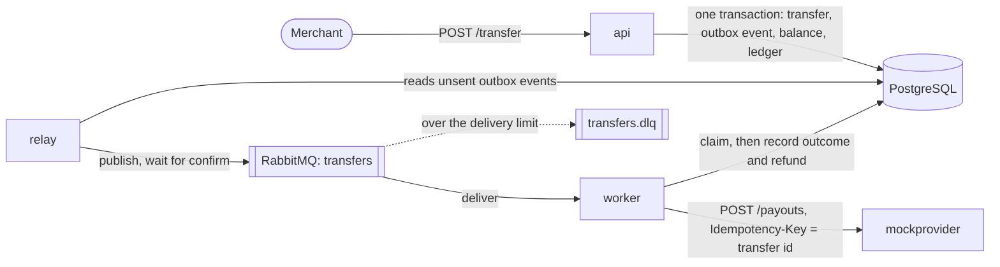

# moneytransfer

A payout service in Go. A merchant submits a bank transfer with `POST /transfer`; the merchant
balance is deducted right away, and the payout happens in the background through RabbitMQ and a
payment provider. A failed payout is refunded. Postgres keeps balances, transfers and a ledger
of every balance change.

What it guarantees:

- Concurrent requests never overdraw the balance.
- A retried request (same `Idempotency-Key`) never creates a second transfer.
- A transfer is never paid out twice, even when the provider times out or a worker crashes.
- A failed transfer is refunded exactly once, and only when the provider says it failed.
- The balance always equals the sum of its ledger entries.

Stack: Go 1.26, PostgreSQL 18, RabbitMQ 4.3 (quorum queues), Docker Compose.

## Important notes

### Data protection

Recipient bank details are personal data under Indonesia's Personal Data Protection Law
(UU 27/2022), and account numbers count as specific (financial) personal data. The service:

- masks account numbers everywhere except the database: logs and API responses show `****6789`;
- never logs request bodies or the transfer description, and never puts personal data in error
  messages;
- sends only ids through RabbitMQ (`transfer_id`, `correlation_id`), so the broker and its UI
  hold no personal data;
- keeps the full values only in Postgres, which the payout needs and which serves as the audit
  trail. Logs reach a transfer through its `transfer_id` or `correlation_id`.

Not done here, needed in production: encryption of account numbers at rest, a retention and
deletion policy, database access auditing, and a breach-notification process (the law gives
3 x 24 hours).

### Other notes

- Amounts are integers in whole rupiah (IDR only). There are no fractions anywhere.
- Passwords in `docker-compose.yml` and `.env.example` are local development values.
- There is no authentication: one hardcoded merchant (`merchant_id = 1`).

## Quick start

Requirements: Docker Engine 25+ with Compose v2.20+ (Docker Desktop works). `make` is optional;
every target's raw command is shown next to it. Go 1.26 is only needed to run the tests outside
Docker. The commands are for bash; on Windows use Git Bash or WSL (in Windows PowerShell,
`curl` is a different command).

### 1. Run it

```bash
make up
```

Without make: `docker compose up -d --build --wait`. This builds one image with all binaries,
starts Postgres, RabbitMQ and the services, runs the migrations, and seeds merchant 1 with
1,000,000,000 rupiah. It returns once everything is healthy.

| Service | What it does | Host port |
|---|---|---|
| `api` | HTTP API: validates, deducts the balance, stores the transfer | `18080` |
| `relay` | Publishes stored events to RabbitMQ | - |
| `worker` | Calls the provider, records the outcome, refunds failures | - |
| `mockprovider` | Fake bank with random delays and outcomes | - |
| `postgres`, `rabbitmq` | Storage and broker (RabbitMQ UI: user and password `moneytransfer`) | `18672` (UI) |
| `migrate`, `seed` | One-shot jobs that create the schema and the merchant | - |

Ports and every other setting can be changed in a `.env` file (copy `.env.example`, which lists
all variables with their defaults).

### 2. Try it by hand

Submit a transfer:

```bash
curl -i -X POST localhost:18080/transfer \
  -H 'Content-Type: application/json' \
  -H 'Idempotency-Key: demo-1' \
  -d '{"amount":150000,"currency":"IDR","bank_code":"BCA","account_number":"1234566789","account_holder_name":"Budi Santoso","reference_id":"INV-001"}'
```

```
HTTP/1.1 202 Accepted
Location: /transfer/01a1d891-e9f2-7ee6-9809-e740d06dba54
X-Correlation-Id: 69306aea-ab47-406d-a3bd-61fa8c0257c6

{"id":"01a1d891-e9f2-7ee6-9809-e740d06dba54","status":"PENDING","amount":150000,"currency":"IDR",
 "bank_code":"BCA","account_number":"****6789","account_holder_name":"Budi Santoso",
 "reference_id":"INV-001","failure_code":null,"created_at":"...","updated_at":"..."}
```

The api answers in a few milliseconds, with the balance already deducted. The payout runs in the
background; the fake bank takes 0.2-2 seconds to answer (`MOCK_MIN_DELAY` and `MOCK_MAX_DELAY`
in `.env`), so check again a moment later:

```bash
curl localhost:18080/transfer/01a1d891-e9f2-7ee6-9809-e740d06dba54
```

```
{"id":"01a1d891-...","status":"SUCCESS",...}
```

About 1 in 10 transfers ends `FAILED` and a few end `UNKNOWN`. That is on purpose: see
[Simulated provider errors](#simulated-provider-errors).

Send the same POST again: the answer is the same transfer with `Idempotent-Replayed: true`, and
nothing is deducted twice. Change the body but keep the key, and the answer is
`422 IDEMPOTENCY_KEY_REUSED`. Use a new key for a new transfer.

#### Simulated provider errors

The fake provider fails on purpose, so the failure paths can be seen, in two ways.

**On demand.** Account numbers ending in these digits always give the same outcome:

| Ends in | Provider does | Transfer ends as |
|---|---|---|
| `0001` | Rejects with `INVALID_ACCOUNT` | `FAILED` (`failure_code: INVALID_ACCOUNT`), balance refunded |
| `0002` | Pays, but the answer arrives after the worker gave up | `SUCCESS` after a retry with the same key, paid once |
| `0003` | Answers 503 every time | `UNKNOWN` after 3 attempts, money stays held |
| `0004` | Rejects with a code the service doesn't know | `UNKNOWN`, money stays held (never refunded on a guess) |

**At random,** for any other account number:

- about 10% are rejected with a bank error such as `REJECTED_BY_BANK`;
- about 5% are paid, but the answer comes too late; the worker retries and gets `SUCCESS`;
- about 5% get a 503; the worker retries, and most of them end `SUCCESS`.

The three percentages are settings of the fake provider: `MOCK_FAILURE_PERCENT` (default 10),
`MOCK_TIMEOUT_PERCENT` (5) and `MOCK_UNAVAILABLE_PERCENT` (5). Setting all three to 0 turns the
random errors off, for example for a clean demo. Only the fake provider restarts; the data stays.

*Option 1, for one run (bash).* Type this in the terminal, in the project folder:

```bash
MOCK_FAILURE_PERCENT=0 MOCK_TIMEOUT_PERCENT=0 MOCK_UNAVAILABLE_PERCENT=0 make up
```

To turn the random errors back on, type:

```bash
make up
```

*Option 2, until changed back (any terminal).* Copy the example settings file to `.env`:

```bash
cp .env.example .env
```

Open `.env` in an editor, change these three lines to 0, save, and run `make up`:

```
MOCK_FAILURE_PERCENT=0
MOCK_TIMEOUT_PERCENT=0
MOCK_UNAVAILABLE_PERCENT=0
```

To turn them back on, set the lines back to 10, 5 and 5 (or delete `.env`), and run `make up`
again. `.env` is local only; git ignores it.

**What happens after an error.** The worker retries timeouts and 503s by itself, up to 3 attempts,
always with the same provider key, so a retry never pays twice. Then:

- `FAILED` is final, and the amount is already back on the balance. To try again, send a new
  request with a new `Idempotency-Key`; the old key returns the failed transfer.
- `UNKNOWN` means the provider gave no clear answer, so the bank may have paid. The money stays
  held. Don't resubmit, which could pay twice; it needs a check with the provider (see
  [Cut corners](#cut-corners)).

Request rules:

| Field | Rule |
|---|---|
| `Idempotency-Key` header | Required, 1-255 characters |
| `amount` | JSON integer, 1 to 250,000,000 |
| `currency` | `IDR` |
| `bank_code` | 2-20 letters or digits |
| `account_number` | 5-20 digits (kept as text, leading zeros matter) |
| `account_holder_name` | 1-100 characters |
| `reference_id`, `description` | Optional, up to 64 and 255 characters |

Unknown fields are rejected, and all field errors come back at once. Errors use RFC 9457
problem details with a stable `code`:

```
{"type":"about:blank","title":"Bad Request","status":400,"detail":"The request has invalid fields.",
 "code":"VALIDATION_FAILED","correlation_id":"9a4d05a9-...",
 "errors":[{"field":"amount","message":"must be greater than 0"},{"field":"currency","message":"must be IDR"}]}
```

| Status | When |
|---|---|
| 202 | Accepted, also for a replay |
| 400 | Invalid fields, malformed JSON, missing `Idempotency-Key` |
| 404 | Unknown transfer id |
| 413, 415 | Body over 16 KB, not `application/json` |
| 422 | `INSUFFICIENT_BALANCE` (nothing stored; a retry with the same key is checked again) or `IDEMPOTENCY_KEY_REUSED` |
| 503 | Database unreachable or too slow; retry with the same key |

### 3. Burst test

```bash
make loadtest WORKERS=3
```

Without make, two commands:

```bash
docker compose up -d --build --wait --scale worker=3
docker compose run --rm --build --no-deps loadtest
```

> **Keep `--no-deps`.** `docker compose run` without it resets the dependencies to the worker
> count in `docker-compose.yml`, which silently stops workers 2 and 3 in the middle of a scaled
> setup.

What it sends, for 30 seconds:

- 20 requests per second, each started on schedule whether or not earlier ones answered, with at
  most 20 waiting at once. Latency counts from the planned start, so a stalled api shows up in
  p99 instead of slowing the test down.
- Random amounts between 50,000 and 5,000,000. The run spends a bit more than the seeded balance,
  so it ends with `422 INSUFFICIENT_BALANCE` answers.
- About 10% duplicate keys: half are later retries, half are sent twice at the same moment.
- About 5% accounts ending in `0001`-`0004`.

Then it waits until none of its transfers is `PENDING` or `PROCESSING` and checks Postgres:

1. Every transfer finished.
2. The balance is not negative.
3. The balance dropped by exactly the amounts of the transfers that are not `FAILED` (a failed
   transfer is refunded; `SUCCESS` and `UNKNOWN` keep the money).
4. Each accepted idempotency key has exactly one transfer.

A run on a laptop with 3 workers:

```
Load test 20261114T054042Z-b5fa
  target     http://api:8080, 20 requests/s for 30s, at most 20 in flight
  balance    1003091186 at the start, amounts 50000-5000000

Traffic
  requests   626 sent, 0 skipped (no free slot), 20.9/s
  latency    p50 5ms, p95 8ms, p99 11ms
  202 new    462
  202 replay 57
  422        107
  no answer  0

Transfers created: 462 (waited 1s for their outcomes after sending)
  SUCCESS     399  amount 971502196
  FAILED       50  amount 139963469
  UNKNOWN      13  amount 31493032

Checks
  PASS  all transfers finished: none left PENDING or PROCESSING
  PASS  balance is not negative: balance at the end 95958
  PASS  balance drop equals the amounts held by transfers: balance dropped by 1002995228, transfers not FAILED hold 1002995228
  PASS  one transfer per accepted idempotency key: 462 accepted keys, 462 transfers, 0 missing, 0 unexpected; 0 uncertain keys (0 stored)

PASS
```

Exit code 0 means every check passed, 1 means a check failed, 2 means the run couldn't be judged
(setup problem, transfers still in flight at the start, or the balance moved for another reason
during the run, which is reported as `INVALID`). A second run needs more money: see step 6.

### 4. Check it yourself

The balance and its ledger (the two numbers are always equal):

```bash
docker compose exec postgres psql -U moneytransfer -c \
  "SELECT balance, (SELECT sum(amount) FROM balance_entries WHERE merchant_id = 1) AS ledger_sum FROM merchants WHERE id = 1;"
```

Transfers by status:

```bash
docker compose exec postgres psql -U moneytransfer -c \
  "SELECT status, count(*), sum(amount) FROM transfers GROUP BY status ORDER BY status;"
```

A failed transfer's ledger entries, a debit and its refund:

```bash
docker compose exec postgres psql -U moneytransfer -c \
  "SELECT type, amount, balance_after FROM balance_entries WHERE transfer_id = '<id>' ORDER BY id;"
```

One request through every service, by the correlation id from the response header:

```bash
docker compose logs api worker | grep 69306aea-ab47-406d-a3bd-61fa8c0257c6
```

The RabbitMQ UI at http://localhost:18672 shows the `transfers` queue and the `transfers.dlq`
dead-letter queue.

### 5. Run the tests

| Command | What runs | Needs |
|---|---|---|
| `make test` (`go test ./...`) | Unit tests | Go 1.26 |
| `make test-integration` (`go test -tags=integration -p 1 ./...`) | Unit + integration tests against real Postgres and RabbitMQ (testcontainers) | Go 1.26, Docker |
| `make test-race` | Unit tests with the race detector | Docker |
| `make lint` | golangci-lint | Docker |

The integration tests cover the parts where money can go wrong: concurrent deductions on one
balance, concurrent duplicate keys, rollback when a step fails or panics, commit errors, a refund
that two workers race for, relays that compete for the same rows, and a poison message that
reaches the dead-letter queue after exactly the configured number of redeliveries.

### 6. Top up or reset

```bash
make topup AMOUNT=1000000000
```

Without make: `docker compose run --rm --build --no-deps loadtest topup 1000000000`. A top-up goes
through the same code as a refund and writes a `DEPOSIT` ledger entry, so the ledger still
explains the balance. Don't top up during a load test: the run would be `INVALID`.

`make down` stops everything and keeps the data. `docker compose down -v` also deletes the data;
the next `make up` starts again from the seeded balance.

## Architecture



A transfer moves through these statuses:

```
PENDING -> PROCESSING -> SUCCESS
                      -> FAILED   (refunded in the same transaction)
                      -> UNKNOWN  (no definite answer from the provider; money stays held)
```

| Package | Role |
|---|---|
| `internal/transfer` | Core: domain types, validation, submit and payout flows, ports. Imports no database, broker or HTTP library (enforced by the linter). |
| `internal/adapter/httpapi` | HTTP handlers, RFC 9457 errors, correlation id and access log middleware |
| `internal/adapter/postgres` | Unit of work, repositories, outbox store |
| `internal/adapter/rabbitmq` | Publisher with confirms, consumer, queue topology |
| `internal/adapter/provider` | HTTP client for the payout provider |
| `internal/outbox` | Relay loop |
| `internal/mockprovider` | The fake bank |
| `internal/loadtest` | Burst test and checks |
| `internal/config`, `internal/logging`, `internal/health` | Env config, correlation id in logs, health endpoints |
| `cmd/*` | One `main` per binary, wiring only |
| `migrations/` | Schema (golang-migrate) |

### Why it is built this way

**One conditional UPDATE guards the balance.**
`UPDATE merchants SET balance = balance - $1 WHERE id = $2 AND balance >= $1`: Postgres locks the
row, so concurrent requests for the same merchant queue up, and zero updated rows means
insufficient balance. There is no read-then-write to race on, and `CHECK (balance >= 0)` backs it
up. Optimistic locking or `SERIALIZABLE` would turn one busy row into a storm of retries.

**Transfer, event, balance and ledger commit together (transactional outbox).**
The api never talks to RabbitMQ. It writes the transfer, an outbox row, the balance change and a
ledger entry in one transaction, and the relay publishes the outbox row afterwards. There is no
transfer without its message and no message without its transfer.

**Every balance change has a ledger entry.**
Each entry stores `balance_after` and the merchant's version number, written under the row lock.
The balance can be rebuilt from the entries, and a missing entry shows up as a gap in the
versions.

**Idempotency is enforced by the database.**
`UNIQUE (merchant_id, idempotency_key)` on transfers: a retry finds the original and gets it back,
a retry with a different body is rejected. A retry that arrives while the original is still
committing waits a few milliseconds for it, instead of getting a "try again" error. Declined
requests store nothing, so the same key can succeed after a top-up.

**The relay marks only what RabbitMQ confirmed.**
It publishes with publisher confirms and `mandatory` (a message no queue accepts counts as a
failure), marks rows as sent only after the confirm, and stops at the first failure. Rows are
locked with `FOR UPDATE SKIP LOCKED`, so several relays can run. Delivery is at least once; the
worker handles duplicates.

**No transaction stays open during the provider call.**
The worker claims the transfer in a short transaction, calls the provider with nothing locked,
and records the outcome in a second transaction. The provider's idempotency key is the transfer
id, so a retry, a redelivered message or a second worker gets the stored answer instead of a
second payout.

**Refund only on an explicit, known failure.**
Timeouts, 5xx answers and unknown failure codes are retried with exponential backoff and full
jitter, then the transfer becomes `UNKNOWN` and keeps the money. Refunding a transfer the bank
actually paid would pay it twice. The refund runs in the same transaction as the move to
`FAILED`, guarded by `WHERE status = 'PROCESSING'`, so two workers can't both refund.

**Failed messages are handled by cause.**
A malformed message or an unknown transfer is rejected and goes to the dead-letter queue. An
unexpected error is rejected with requeue, redelivered up to 5 times, then dead-lettered. On
shutdown, unfinished messages are returned uncounted. While the database is down, the worker
waits and retries instead of crashing, because RabbitMQ counts every crash against the delivery
limit of each message in flight.

**Crash on broker connection loss instead of reconnecting.**
The relay and the worker exit, and Docker restarts them. A restart loses nothing: unsent events
wait in the outbox, unacknowledged messages are redelivered, and processing is idempotent. This
reuses the normal startup path instead of adding reconnect logic.

**Messages carry ids only.**
The worker loads the transfer from Postgres, so the broker, its UI and the dead-letter queue hold
no personal data.

**The load test reads results from Postgres.**
The guarantees are about stored money, and the API has no balance endpoint (an unauthenticated
one would be a hole). The checks are plain SQL, the same queries as in step 4.

## Assumptions

- "Serialized" balance updates means Postgres row locking under `READ COMMITTED`, not
  `SERIALIZABLE` for every transaction: the conditional UPDATE gives the same safety for this
  single-row check without serialization failures.
- Rolling back the balance means a compensating refund in a later transaction, recorded as a
  `REFUND` ledger entry, not undoing the original transaction.
- One currency, IDR, in whole rupiah. Banks settle IDR payouts in whole units, so every stored
  amount is an integer.
- The maximum per transfer is 250,000,000 rupiah, the BI-FAST per-transaction limit
  (configurable).
- An `Idempotency-Key` identifies one intended transfer. A successful submit is never repeated.
  Declines, validation errors and server errors store nothing, so the same key is evaluated
  again. Keys don't expire.
- `reference_id` is the merchant's own reference and doesn't have to be unique; duplicates are
  caught by the idempotency key.
- The account holder's name is returned as sent; only the account number is masked.
- Paths are singular as specified (`/transfer`). A public API would use `/v1/transfers`.
- The mock provider keeps payouts in memory (a restart forgets every key, which a real provider
  wouldn't), records the outcome before its delay (so a caller that gives up may already have been
  paid, like a real bank), records nothing on a 503, and is reachable only inside the compose
  network. Its outcomes are random and unseeded; the account suffixes above give repeatable
  cases.

## Cut corners

- **No authentication.** Anyone who knows a transfer id can read it (ids are UUIDv7 and responses
  are minimized). In production: authenticate the merchant, query by id and merchant, and answer
  404 for other merchants' transfers.
- **No reconciler.** An `UNKNOWN` transfer stays `UNKNOWN` and keeps its money. Resolving it needs
  an ops action that reuses the worker's finish-and-refund code; editing the rows by hand would
  skip the refund, the ledger entry and the version.
- **Alerts are log lines only.** `alert=outbox_backlog`, `alert=provider_unrecognized_response`
  and `event=transfer_unknown` are structured fields for a log platform to alert on. Routing to
  chat or paging belongs in the monitoring platform (grouping, silencing, on-call), which isn't
  part of this setup.
- **One api instance, no CI pipeline, no metrics endpoint.** The api is stateless and can run
  behind a load balancer as is. Tests and lint run locally through `make`.
- **Account numbers are stored in plain text** in Postgres (masked everywhere else).
- **The mock provider's `/stats` and key store grow without bound**, which is fine for a demo.

## Future improvements

Correctness and money
- A reconciler that finds `UNKNOWN` and stuck transfers and asks the provider's status endpoint
  (or listens to its webhooks), with a cap and an alert when it gives up.
- An ops command to resolve `UNKNOWN` transfers through the same finish-and-refund code.
- A periodic ledger check (balance = sum of entries, versions without gaps) with a critical alert.
- A status history table, for a permanent timeline of each transfer.
- An idempotency-key table with expiry, once more endpoints need idempotency.

Scale
- A single balance row allows about one deduction per lock hold. For a very busy merchant, split
  the balance into several rows or batch deductions.
- `SELECT ... FOR UPDATE` instead of the conditional UPDATE when a deduction needs rules checked in
  Go (daily limits, fees) or touches several accounts (locks taken in a fixed order).
- Delayed retries through RabbitMQ (a retry queue, or scheduled delivery in RabbitMQ 4.4) when
  provider retries need minutes, so they don't occupy worker slots.
- Batched or asynchronous publisher confirms if the relay becomes the bottleneck.
- Outbox retention: delete published rows after some days, or partition by date and drop old
  partitions.

Operations
- Metrics: transfers by status, outbox lag, dead-letter queue depth, provider latency and
  timeouts, API latency, with alert rules.
- A circuit breaker around the provider that pauses consuming while open (never marking
  transfers `FAILED`).
- Per-merchant rate limiting at the gateway.

Security and data
- Authentication and merchant-scoped queries.
- Encryption or tokenization of account numbers, database access auditing, and a retention and
  deletion policy.
